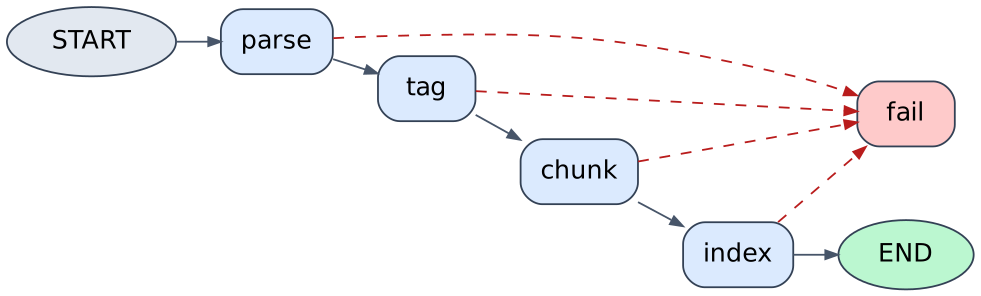

# Document Agent – architecture (Milestone 1)



## Flow for one PDF

| Step | Node | What happens | Status written |
|------|------|--------------|----------------|
| 1 | parse | PyMuPDF reads every page | `parsing` |
| 2 | tag | Rule-based tagger labels each page (section, scope, unit, printed page, **tier**). Every page's text + tags are stored in `page_tags` (no embedding, no quota). | `tagging` |
| 3 | chunk | Tier-1 pages only. Statement pages are re-read with a layout pass; one page = one chunk (split on row boundaries if >16 KB). Narrative: 4 KB chunks, 200 overlap. | `chunking` |
| 4 | index | Gemini `gemini-embedding-001` → Chroma Cloud. Resumable: already-stored chunk ids are skipped; progress is saved after every batch. | `indexing` → `ready` |
| – | fail | Any error: message saved on the document. A daily Gemini quota error stops immediately (no retries). | `failed` |

## Tiers

* **Tier 1** – balance sheet, profit & loss, cash flow, equity changes, auditor's report, MD&A, notes. Embedded right after upload (~8 % of the chunks).
* **Tier 2** – everything else (cover, business overview, ESG …). Text is stored; pages are embedded **on demand**:
  `POST /documents/{id}/index-more {"query": "...", "limit": 5}` keyword-searches the stored text, embeds only the best matching pages and marks them indexed. `Document.status` stays `ready`.

Set `INDEX_MODE=full` to embed everything instead.

## Chunk ids and metadata

* id: `<doc_id>:<pdf_page>:<k>` – based on the page, so embedding more pages later never changes existing ids.
* metadata: `doc_id, session_id, company, fiscal_year, pdf_name, pdf_page, printed_page, section, scope, unit, content_type, source_type, tier`.

## Commands

```
alembic upgrade head              # creates the new page_tags columns
python -m app.seed                # seed the 4 reports (resumes where it stopped)
python -m app.seed --reprocess    # re-run even documents already `ready`
```
