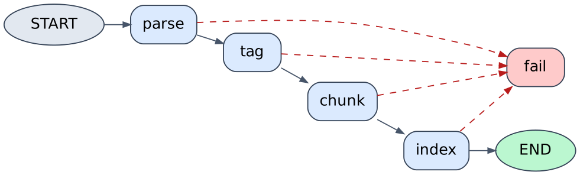

# Document Agent – architecture (Milestone 1)



## Flow for one PDF

| Step | Node | What happens | Status written |
|------|------|--------------|----------------|
| 1 | parse | PyMuPDF reads every page | `parsing` |
| 2 | tag | Rule-based tagger labels each page (section, scope, unit, printed page, **tier**). Every page's text + tags are stored in `page_tags` (no embedding, no quota). | `tagging` |
| 3 | chunk | Tier-1 pages only. Statement pages are re-read with a layout pass; one page = one chunk (split on row boundaries if >16 KB). Narrative: 4 KB chunks, 200 overlap. | `chunking` |
| 4 | index | Gemini `gemini-embedding-001` → Chroma Cloud. Resumable: already-stored chunk ids are skipped; progress is saved after every batch. | `indexing` → `ready` |
| – | fail | Any error: message saved on the document. A daily Gemini quota error stops immediately (no retries). | `failed` |

## Tiers

* **Tier 1** – balance sheet, profit & loss, cash flow, equity changes, auditor's report, MD&A, notes. Embedded right after upload (~8 % of the chunks).
* **Tier 2** – everything else (cover, business overview, ESG …). Text is stored; pages are embedded **on demand**:
  `POST /documents/{id}/index-more {"query": "...", "limit": 5}` keyword-searches the stored text, embeds only the best matching pages and marks them indexed. `Document.status` stays `ready`.

Set `INDEX_MODE=full` to embed everything instead.

## Chunk ids and metadata

* id: `<doc_id>:<pdf_page>:<k>` – based on the page, so embedding more pages later never changes existing ids.
* metadata: `doc_id, session_id, company, fiscal_year, pdf_name, pdf_page, printed_page, section, scope, unit, content_type, source_type, tier`.

## Commands

```
alembic upgrade head              # creates the new page_tags columns
python -m app.seed                # seed the 4 reports (resumes where it stopped)
python -m app.seed --reprocess    # re-run even documents already `ready`
```

---

# Milestone 2: Extraction, Red Flag and the orchestrator

```
Orchestrator graph (run_pipeline, one run per uploaded document)
  document  ->  extraction  ->  red_flag  ->  END
     |              |
     +-- failed ----+-- failed -> skip (later agents marked "skipped")

Document agent    : parse -> tag -> chunk -> index          (unchanged)
Extraction agent  : load -> extract -> verify -> ratios -> save
Red Flag agent    : load -> rules -> auditor -> save
```

Each agent is its own LangGraph graph; the orchestrator is a parent graph whose
nodes call them. A failed agent never breaks the one before it: if extraction
fails, the document stays READY and searchable, red flags are marked `skipped`.

## Extraction Agent
* Reads the stored statement pages from `page_tags` (layout text for statements). No Chroma, no embedding quota.
* One Gemini call per statement (P&L, balance sheet, cash flow), `gemini-3.8-flash`, forced into a JSON shape. The model only **copies** numbers plus the page and the source line.
* Verify, in code: (1) every number must literally appear on the page it cites, otherwise `needs_review`; (2) statements must agree with themselves (assets = liabilities + equity, current assets <= total assets ...).
* Total debt, margins, debt/equity, current ratio, ROE, growth, free cash flow are **calculated in code**, each with its formula. A ratio inherits `needs_review` from its inputs.
* Output: table `metrics` (`kind` = extracted | derived | ratio, `status`, `source_page`, `source_text`, `formula`, `note`).

## Red Flag Agent (no LLM)
* Rules over verified metrics: net loss, revenue decline, falling margin, rising debt, high leverage, weak liquidity, profit not backed by cash, receivables outpacing sales. Thresholds sit at the top of `app/agents/red_flag_agent/rules.py`.
* Auditor's report scan: only heading lines count (qualified / adverse opinion, disclaimer, material uncertainty related to going concern, emphasis of matter), so standard clean-report wording does not trigger.
* Output: table `red_flags` (`type`, `severity`, `title`, `description`, `evidence`, `source_page`).

## API
* `GET /documents/{id}/metrics`, `GET /documents/{id}/red-flags`
* `POST /documents/{id}/analyze` re-runs both agents (for example after a quota failure)
* Document responses include `extraction_status` and `red_flag_status` (queued | running | done | failed | skipped)

## Commands
```
alembic upgrade head                      # adds the Milestone 2 columns (0003)
python -m app.seed --reprocess            # re-read seeds, then run both agents
python -m app.validate_agents             # print metrics, flags, faithfulness for all documents
python -m app.validate_agents --doc <uuid> --golden tests/golden/apple_fy2025.json
```
Set `RUN_AGENTS=false` to run only the Document Agent.
